<!-- Perfil de beuren33. Cada bloco é um SVG em assets/ (claro e escuro); os números de projetos e commits são um retrato de 15/11/2026. -->

<picture><source media="(prefers-color-scheme: light)" srcset="assets/header-light.svg"></picture>
<picture><source media="(prefers-color-scheme: light)" srcset="assets/hero-light.svg"></picture>
<a href="https://github.com/beuren33/gpt-machado-de-assis-pytorch"><picture><source media="(prefers-color-scheme: light)" srcset="assets/row-gpt-machado-de-assis-pytorch-light.svg"></picture></a>
<a href="https://github.com/beuren33/rice-leaf-disease-segmentation"><picture><source media="(prefers-color-scheme: light)" srcset="assets/row-rice-leaf-disease-segmentation-light.svg"></picture></a>
<a href="https://github.com/beuren33/face-generation-gan-celeba"><picture><source media="(prefers-color-scheme: light)" srcset="assets/row-face-generation-gan-celeba-light.svg"></picture></a>
<a href="https://github.com/beuren33/mlops-churn-prediction"><picture><source media="(prefers-color-scheme: light)" srcset="assets/row-mlops-churn-prediction-light.svg"></picture></a>
<a href="https://github.com/beuren33/cloudapp-infra"><picture><source media="(prefers-color-scheme: light)" srcset="assets/row-cloudapp-infra-light.svg"></picture></a>
<a href="https://github.com/beuren33/stack_tf"><picture><source media="(prefers-color-scheme: light)" srcset="assets/row-stack_tf-light.svg"></picture></a>
<picture><source media="(prefers-color-scheme: light)" srcset="assets/cert-light.svg"></picture>
<a href="https://www.linkedin.com/feed/"><picture><source media="(prefers-color-scheme: light)" srcset="assets/link-linkedin-light.svg"></picture></a>
<a href="https://www.instagram.com/beuren.matheus/"><picture><source media="(prefers-color-scheme: light)" srcset="assets/link-instagram-light.svg"></picture></a>
<a href="https://lattes.cnpq.br/0252647466951418"><picture><source media="(prefers-color-scheme: light)" srcset="assets/link-lattes-light.svg"></picture></a>

